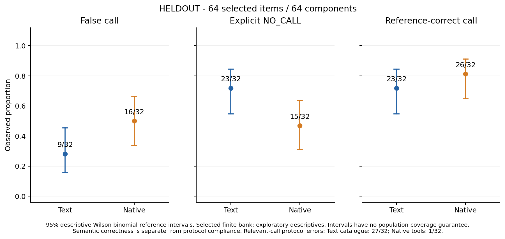
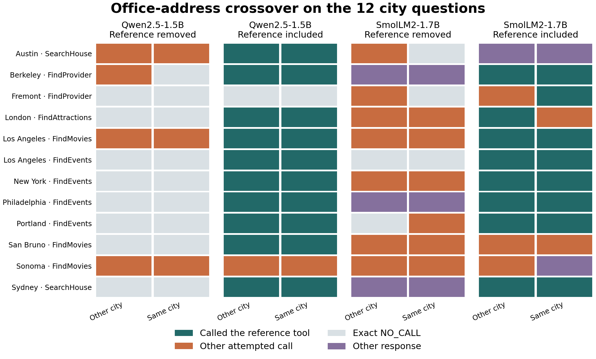

# When does a language model call a tool it cannot use?

Qwen2.5 sometimes tried to use a tool that could not answer the question. In Mateenah Jahan’s Technical Alignment Research Accelerator (TARA) study, even the way the tool list was displayed changed how often this happened. Two follow-ups asked which words in a tool description influenced that decision and whether the effect held with documentation written by others.

[Paper and supplement on tool descriptions (PDF)](followup_v3_tool_documentation/TARA_Tool_Applicability.pdf) · [Original TARA results](study_v1/RESULTS.txt) · [External questions and model replies](followup_v3_tool_documentation/independent_descriptions/README.md)

## 1. The same requests, two tool formats

Qwen2.5-1.5B-Instruct received the same 64 held-out requests from the Berkeley Function Calling Leaderboard (BFCL) twice. One version listed the tool in the prompt. The other used the model’s native tool template. A call here means the model generated a call attempt. The experiments never executed a function.

| What the model did | Text list | Native format |
|---|---:|---:|
| Attempted a call when no tool applied | 9/32 | 16/32 |
| Returned exactly `NO_CALL` when no tool applied | 23/32 | 15/32 |
| Named the correct function and supplied the right arguments when a tool applied | 23/32 | 26/32 |
| Used the prescribed call format when a tool applied | 0/32 | 31/32 |

With the native format, Qwen made seven more false attempts and three more correct calls. Two completions reached the token limit and remain in the counts. [Saved replies](study_v1/runs/heldout/) · [Paired estimates and uncertainty](study_v1/reports/behaviour_heldout.json)

Logistic probes predicted the benchmark’s applicability labels from Qwen’s activations with AUROCs of 0.898–0.946 across the two formats. A baseline using question and description lengths, prompt length and schema size reached 0.814. The relevant and irrelevant questions came from different BFCL files, so wording and source could help distinguish them. Steering the native-format activations left false calls at 2/8 and reduced correct calls from 7/8 to 6/8 on the held-out subset. Text-format steering failed the development criterion for a held-out test. [Probes and controls](study_v1/reports/heldout_probe_results.json) · [Steering results](study_v1/RESULTS.txt)

## 2. One word changes which tool applies

Across 20 pairs, changing one word put the request outside the scope of a fictional tool, such as a menu lookup or a route finder. On those 20 out-of-scope requests, the native format increased false attempts in both models. The models ran on different software and at different precision. Each comparison below is within one model.

| Model | False attempts with a text list | False attempts with the native format |
|---|---:|---:|
| Qwen2.5-1.5B | 14/20 | 19/20 |
| Qwen3.5-4B | 0/20 | 10/20 |

[All outcomes and paired counts](followup_v2_tool_applicability/RESULTS.md) · [Requests and tool definitions](followup_v2_tool_applicability/bank.json) · [Pair design](followup_v2_tool_applicability/figures/study_design.svg)

## 3. Does the model confuse a documentation address with service coverage?

A directory listed both the district a service covered and the office where its manual was written. When the service was out of scope, changing only the office to the requested district turned 70 abstentions into false calls across 128 paired Qwen2.5 requests. SmolLM2-1.7B attempted a call in both conditions on all 128 pairs. On 32 of those out-of-scope Qwen requests, replacing the office word’s input embedding reversed all 32 false calls. Replacing its activation at block 14 reversed none. [Fictional directories and intervention results](followup_v3_tool_documentation/README.md)

The office effect did not recur on the 12 eligible city questions drawn from BFCL and When2Call. With the correct tool removed, matching the office city changed false attempts from 4/12 to 3/12 for Qwen and from 7/12 to 6/12 for SmolLM2. In a separate test offering one unrelated tool under its original name, Qwen attempted 3/60 calls and SmolLM2 attempted 48/60. Only 3 and 24, respectively, supplied a standalone call with arguments valid under the tool schema. [Question selection, scoring and parser disagreements](followup_v3_tool_documentation/independent_descriptions/README.md)

## Reproducing the results

| Study | Inputs and protocol | Responses and checks |
|---|---|---|
| BFCL formats | [Setup](study_v1/proposal/README.txt) · [Pinned dependencies](study_v1/proposal/requirements.txt) · [BFCL revision](https://github.com/ShishirPatil/gorilla/tree/6ea57973c7a6097fd7c5915698c54c17c5b1b6c8) · [Model revision](https://huggingface.co/Qwen/Qwen2.5-1.5B-Instruct/tree/989aa7980e4cf806f80c7fef2b1adb7bc71aa306) | [Development](study_v1/runs/dev/) · [Held-out](study_v1/runs/heldout/) · [File checksums](COMPLETED_PUBLIC_MANIFEST.json) · [Activation array checksums](study_v1/ACTIVATION_ARTIFACT_MANIFEST_FINAL.json) |
| Matched requests | [Protocol](followup_v2_tool_applicability/PROTOCOL.md) · [Model substitution](followup_v2_tool_applicability/AMENDMENT_QWEN25.md) | [Run verification](followup_v2_tool_applicability/verification.json) · [Rescore the replies and rebuild figures](followup_v2_tool_applicability/report.py) |
| Documentation address | [Directory protocols and reproduction commands](followup_v3_tool_documentation/README.md#reproduce-the-experiments) · [External source attribution](followup_v3_tool_documentation/independent_descriptions/ATTRIBUTION.md) | [Rebuild the question banks and rescore 428 replies](followup_v3_tool_documentation/independent_descriptions/README.md#review-and-reproduction) · [Blinded review packet](followup_v3_tool_documentation/independent_descriptions/TARA_Blind_Review.zip) |

The first study’s development run exposed a scoring error for complete JSON calls missing a closing tag. The corrected scorer and fitted parameters were frozen before held-out inference. The second study substituted Qwen2.5-1.5B after Qwen3-4B reached its length limit on setup checks. [Scoring amendment](study_v1/MEASUREMENT_AMENDMENT_V2.json) · [Pre-test release](https://github.com/MateenahJAHAN/tara-chat-tool-study/tree/v0.2-before-heldout) · [Second study diagnostics](followup_v2_tool_applicability/RESULTS.md)

## Use of AI tools

The original TARA project used methods taught in ARENA. Claude Code Opus 5.5 drafted its design and code. Claude Fable 5.2 reviewed the matched-request design. Codex designed and ran the documentation-address follow-up and drafted its report. [ARENA](https://github.com/ARENA-education/ARENA_materials) · [Original project record](study_v1/AI_ASSISTANCE_PROVENANCE.json) · [Follow-up paper](followup_v3_tool_documentation/manuscript.md)
