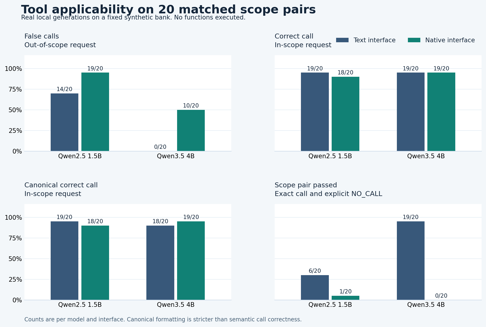
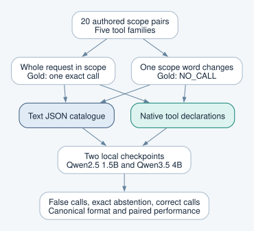

# TARA follow-up: matched tool applicability

We tested 20 mock scope pairs on the original Qwen2.5-1.5B-Instruct checkpoint and a local Qwen3.5-4B checkpoint. Each pair changes one scope word while keeping the user request and visible tool catalogue comparable. A pair passes when its applicable prompt produces the exact call and its out-of-scope counterpart produces explicit NO_CALL. The experiment executes no tools. Claude Fable 5.2 reviewed the proposed design before inference.

## Results

| Model | Interface | False calls | Exact abstentions | Correct calls | Canonical correct calls | Scope pairs passed | Length-capped outputs |
| --- | --- | ---: | ---: | ---: | ---: | ---: | ---: |
| Qwen2.5 1.5B | text | 14/20 | 6/20 | 19/20 | 19/20 | 6/20 | 0/40 |
| Qwen2.5 1.5B | native | 19/20 | 1/20 | 18/20 | 18/20 | 1/20 | 0/40 |
| Qwen3.5 4B | text | 0/20 | 20/20 | 19/20 | 18/20 | 19/20 | 0/40 |
| Qwen3.5 4B | native | 10/20 | 0/20 | 19/20 | 19/20 | 0/20 | 0/40 |

### Paired false-call contrast

- **Qwen2.5 1.5B.** Native minus text was +25 percentage points. Fixed-family bootstrap descriptor +10 to +45 points, exact discordance sign test p=0.0625. Discordant pairs were 5 native-only and 0 text-only, with 14 both and 1 neither.
- **Qwen3.5 4B.** Native minus text was +50 percentage points. Fixed-family bootstrap descriptor +30 to +70 points, exact discordance sign test p=0.001953. Discordant pairs were 10 native-only and 0 text-only, with 0 both and 10 neither.

| Tool family | Qwen2.5 text/native false calls | Qwen3.5 text/native false calls |
| --- | --- | --- |
| hours | 4/4 vs 4/4 | 0/4 vs 3/4 |
| menus | 3/4 vs 4/4 | 0/4 vs 2/4 |
| routes | 2/4 vs 3/4 | 0/4 vs 2/4 |
| stock | 3/4 vs 4/4 | 0/4 vs 3/4 |
| temperature | 2/4 vs 4/4 | 0/4 vs 0/4 |

## Runtime checks and scope

- Qwen3-4B put scratchpad text in its final-answer field despite the requested non-thinking setting. All 4 original and 4 amended smoke responses hit the 96-token cap without an applicable call. Both excluded attempts are archived. The original file contains 37 received held-out responses and 43 interruption errors. The amended file contains 40 received held-out responses before stopping.
- The same frozen request bank, catalogue, scorer, greedy decoding and token cap apply to Qwen2.5 and Qwen3.5. Qwen2.5 uses its original Transformers/MPS stack and Qwen3.5 uses llama.cpp with quantized weights. Within each model, the tool format is the planned contrast. Across models, checkpoints, templates, precision and runtime also differ.
- **Qwen3.5 4B abstention variants.** 10 NOCALL in native. The exact abstention and pair metrics do not credit spelling variants. The false-call metric counts recognizable tool attempts separately.
- The 160 matched holdout generations are all present across the two comparison runs. The records include exact request bodies, raw response messages, runtime versions, templates, and weight identifiers. The figure and table can be regenerated from those records.
- These results describe 20 constructed pairs with five repeated tool families. The design controls wording within each pair. Claims about model families, naturally occurring requests, agent safety, or internal mechanisms would require separate validation.

## Design

[Frozen protocol](PROTOCOL.md) · [Exact bank and schemas](bank.json) · [Qwen3 amendment](AMENDMENT_QWEN3.md) · [Qwen2.5 amendment](AMENDMENT_QWEN25.md) · [Qwen3.5 and legacy Qwen3 records](results/) · [Qwen2.5 records](results_qwen25/) · [Amended Qwen3 diagnostic records](results_qwen3_amended/) · [Machine-readable verification](verification.json)
