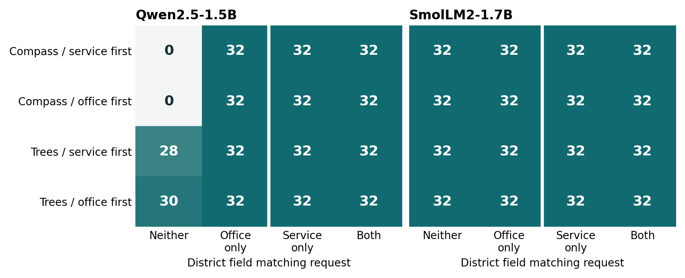
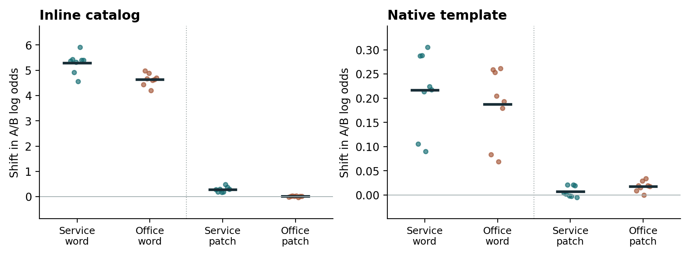
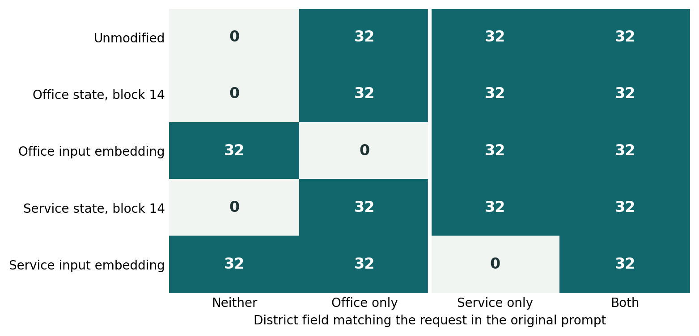

# When a tool’s documentation address matches the request

A service can cover West even when its manual was written in East. Would a model call that service for a request about East? We varied the service district and the documentation office independently, then repeated the office test with published tool descriptions.

[Paper and supplement (PDF)](TARA_Tool_Applicability.pdf) · [Manuscript](manuscript.md) · [Supplementary methods and results](supplement.md) · [Original TARA participant study](https://github.com/MateenahJAHAN/tara-chat-tool-study/tree/b0676becc8354be9849c165db6276f35ce0709ca)

<a id="test-on-external-documentation"></a>

## External documentation

On 12 city questions from BFCL and When2Call, matching the documentation office to the requested city changed false attempts from 4/12 to 3/12 for Qwen2.5 and from 7/12 to 6/12 for SmolLM2. In the single-tool test, Qwen and SmolLM2 generated schema-valid calls to an unrelated function in 3/60 and 24/60 presentations under the original function name. [Questions, results and figures](independent_descriptions/README.md) · [Blinded responses](independent_descriptions/TARA_Blind_Review.zip)

<a id="two-checkpoints-the-same-512-requests"></a>

## Fictional directories

Each model saw the same 512 requests. When the service was out of scope, changing only the office district converted 70 of 128 paired Qwen2.5 decisions from abstention to a false call. SmolLM2 tried to call in both conditions on all 128 pairs. Each model returned the correct function and arguments on all 256 in-scope requests.



[Qwen generations](transfer_01/raw.jsonl) · [SmolLM2 generations](replication_01/raw.jsonl) · [All conditions](paper_cells.csv) · [Paired changes](paper_pairs.csv) · [Individual services](paper_tools.csv) · [Independent response audit](paper_behavior_audit.json)

## Coverage judgments and interventions

The Qwen study also measured how changing one district word, or swapping its activation after block 14, affected the model’s explicit coverage judgment. Its native tool template assigned negligible probability to the requested answer letters. Free responses are scored separately.



[Prompt-level logits](run_01/raw.jsonl) · [Initial action responses](actions_01/raw.jsonl) · [Service contrasts](family_effects.csv) · [Control checks](independent_checks.json) · [All judgment and action estimates](results.json)

## Does the activation swap change a generated call?

Among 32 out-of-scope requests where only the office matched, swapping the office input embedding prevented 32 false calls. A block-14 swap prevented none. Both block-14 field swaps preserved all 64 correct in-scope calls. One false call changed its district argument. All 512 archive, identity and embedding-control comparisons reproduced the expected token sequence.



[Protocol](action_intervention/PROTOCOL.md) · [Inference code](action_intervention/run_generation_patch.py) · [Full generations](action_intervention/run_01/raw.jsonl) · [Cell results](action_intervention/cells.csv) · [Verification](action_intervention/verification.json) · [Recount and figure code](action_intervention/analyze_generation_patch.py)

## Code and study design

- [Service definitions](bank_spec.json), [judgment and patch protocol](PROTOCOL.md), [action protocol](ACTION_PROTOCOL.md), [vocabulary and order protocol](TRANSFER_PROTOCOL.md) and [second-checkpoint protocol](REPLICATION_PROTOCOL.md).
- [Judgment and patch runner](run.py), [generation and scoring](run_actions.py), [Qwen vocabulary transfer](run_transfer.py), [SmolLM2 replication](run_replication.py) and [dependency versions](requirements.txt).
- [Judgment analysis](analyze.py), [independent intervention recount](verify_results.py), [Qwen transfer analysis](analyze_transfer.py), [cross-checkpoint response audit](audit_paper.py) and [paper figures](paper_figures.py).
- [Qwen judgment manifest](run_01/run.json), [Qwen action manifest](actions_01/run.json), [Qwen transfer manifest](transfer_01/run.json) and [SmolLM2 manifest](replication_01/run.json).
- [Recount of the original TARA archive](prior_verification.json) and [archive verification code](audit_prior.py).

## Reproduce the experiments

With the pinned weights in local directories, the following commands run inference into fresh output directories. The independent-checkpoint runner reads the hash-verified original 512 rendered prompts. The analysis commands reproduce counts and figures from the stored raw outputs.

```sh
python run.py --model "$QWEN_DIR" --out repeat_judgments
python run_actions.py --model "$QWEN_DIR" --out repeat_actions
python run_transfer.py --model "$QWEN_DIR" --out repeat_transfer
python run_replication.py --model "$SMOL_DIR" --out repeat_smol
python action_intervention/run_generation_patch.py --model "$QWEN_DIR" --out repeat_patch
python analyze.py
python verify_results.py
python audit_paper.py
python paper_figures.py
python action_intervention/analyze_generation_patch.py
```
