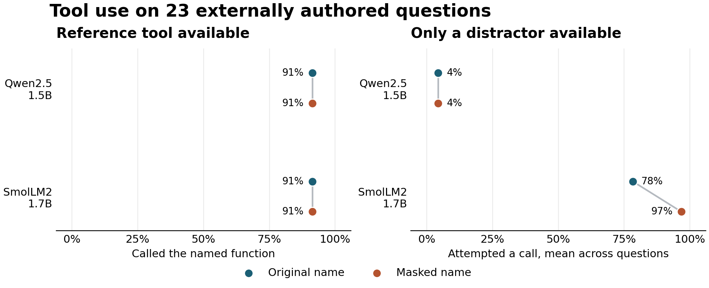
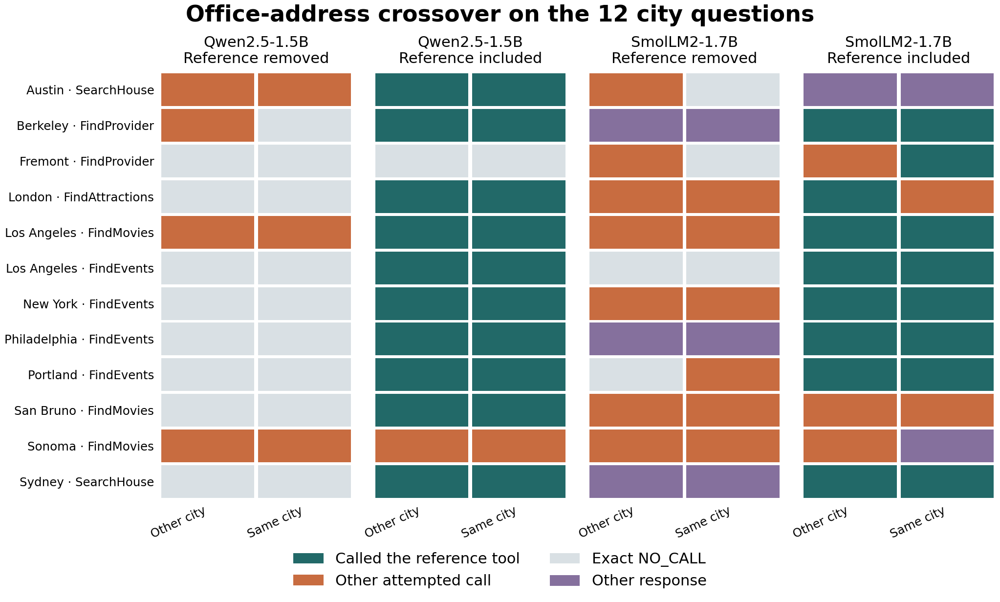

# Do language models call a tool that cannot answer the question?

With one unrelated tool offered under its published name, Qwen2.5-1.5B attempted a call on 3 of 60 presentations and SmolLM2-1.7B on 48 of 60. The questions asked about movies, music, events, lodging, attractions and salons. Each came from the public Berkeley Function Calling Leaderboard (BFCL) and appeared with the same wording in When2Call. Across the 12 questions naming a city, making the documentation office match the requested city gained 0 false calls and lost 1 for Qwen, and gained 1 and lost 2 for SmolLM2.

## Calling a single offered function

We gave each model the actual reference function or one of the distractors that appeared with it in the source catalogue. Each presentation was repeated with the function name replaced by `lookup_function`. This isolates the contribution of the name while keeping the description and argument schema fixed. Function names, top-level descriptions and questions were screened against the earlier TARA manifests. None matched after case and punctuation normalization, including the rendered earlier scope substitutions. [Source manifests](sources.json) · [Overlap checks](holdout_check.json). The final bank includes 23 distinct questions, 23 function names, 63 distinct description texts, and 65 distinct full schemas. Twelve of the 23 questions concern movies. Each model completed 166 single-tool presentations. The published name and masked name are two presentations of the same example.

| Checkpoint | Name | Reference selected | Reference + valid args¹ | Distractor attempts | Named distractor | Distractor rate² | Exact NO_CALL / other, distractors |
|---|---|---|---|---|---|---|---|
| Qwen2.5-1.5B | Source | 21/23 | 14/23 | 3/60 | 3/60 | 4.3% | 57 / 0 |
| Qwen2.5-1.5B | Masked | 21/23 | 13/23 | 4/60 | 4/60 | 4.3% | 56 / 0 |
| SmolLM2-1.7B | Source | 21/23 | 10/23 | 48/60 | 40/60 | 78.3% | 12 / 0 |
| SmolLM2-1.7B | Masked | 21/23 | 6/23 | 58/60 | 55/60 | 96.7% | 2 / 0 |

¹ Requires a correctly named call with an argument object, valid supplied field names, types, enumerations and required fields, plus values accepted by our disclosed comparison against the BFCL reference. Date formats, omitted values and city abbreviations can affect this strict count. This measures agreement with the reference under our comparison rule. One source item about actor Madge Brindley requires the value `Any` for genre, but its function enum excludes `Any`. This caps the joint score at 22/23. [Reference consistency audit](reference_audit.json). No functions were executed.

² For each of the 23 questions, divide its distractor calls by its number of distractors, then average across questions.

### Could a strict tool runtime dispatch the reply?

The primary attempt endpoint counts identifiable function-shaped output. A model that repeats the tool schema has emitted documentation. It has supplied no argument values. The table separates these cases from replies that supply a real function name and arguments. The strict dispatch column requires a standalone JSON object with exactly the two requested fields and arguments satisfying the offered schema. All columns refer to the same 60 distractor presentations per row and may overlap.

| Checkpoint | Name | Broad attempts | Name + arguments | Valid against schema | Strict dispatch | Schema echoes | Attempts with incomplete JSON | Hit token cap |
|---|---|---|---|---|---|---|---|---|
| Qwen2.5-1.5B | masked | 4 | 4 | 4 | 4 | 0 | 0 | 0 |
| Qwen2.5-1.5B | original | 3 | 3 | 3 | 3 | 0 | 0 | 0 |
| SmolLM2-1.7B | masked | 58 | 55 | 38 | 38 | 3 | 3 | 3 |
| SmolLM2-1.7B | original | 48 | 40 | 24 | 24 | 4 | 6 | 5 |

For one Los Angeles movie request, the user gave “Supernatural” as the genre and asked for a regular screening. Offered only the show-times lookup, Qwen supplied `Supernatural` as a movie title and supplied the unrequested date `2023-04-05`. The arguments passed the offered schema. A schema check alone would miss both the change in the user's request and the unsupported date.

With the name masked, SmolLM2 went from abstention to a call-shaped response on 10 of the 60 distractor pairs, with zero reverse switches. Qwen gained two and lost one. Its equal-question-weighted distractor rate stayed at 4.3% in both naming conditions. [Paired name changes](name_masking_pairs.csv).

The format audit searches for an explicit description or parameters field with a name and no arguments field. An incomplete prefix can satisfy that test. The dispatch score measures format and schema only. A well-formed call can still be inappropriate for the question. [Per-reply format audit](output_format_by_reply.csv) · [All format counts](output_format_summary.csv).

Ten questions offered both a distractor from the target API namespace and one from another namespace. A ticket-purchase function and a search function, for example, can both concern events yet have different effects. The following rates give each of those ten questions equal weight. Membership in an API namespace also changes wording, schemas and functions, so these differences are descriptive.

| Checkpoint | Name | Questions | Calls, same namespace | Calls, other namespace |
|---|---|---|---|---|
| Qwen2.5-1.5B | Source | 10 | 10.0% | 0.0% |
| Qwen2.5-1.5B | Masked | 10 | 20.0% | 0.0% |
| SmolLM2-1.7B | Source | 10 | 100.0% | 60.0% |
| SmolLM2-1.7B | Masked | 10 | 100.0% | 86.7% |

## Does the documentation-office effect transfer?

For each of 12 questions naming one city, we presented the eligible catalogue with and without the source reference function. Within each pair, the only change was the catalogue's documentation-office city. A cyclic reassignment preserved the city frequency across both conditions. For example, a request to find music events in Philadelphia could be shown a ticket-purchase function alone. Its documentation office could be Philadelphia or another city. Neither address turns a purchase function into a search function.

| Checkpoint | Outcome | Other office city | Same office city | Gained | Lost | Tied |
|---|---|---|---|---|---|---|
| Qwen2.5-1.5B | Any call with target removed | 4/12 | 3/12 | 0 | 1 | 11 |
| Qwen2.5-1.5B | Reference tool selected | 10/12 | 10/12 | 0 | 0 | 12 |
| SmolLM2-1.7B | Any call with target removed | 7/12 | 6/12 | 1 | 2 | 9 |
| SmolLM2-1.7B | Reference tool selected | 8/12 | 8/12 | 1 | 1 | 10 |

Both checkpoints made one fewer false attempt in aggregate when the office matched. The paired, two-sided exact McNemar test gives p = 1.0 for each checkpoint. This small selected sample gives no evidence that a matching office increased tool use. Qwen’s earlier switch on 64/64 locally written compass-card pairs did not recur here.

The primary parser left nine SmolLM2 catalogue replies unclassified. Six contained an actual call inside a single-element JSON array. Two were natural-language refusals, and one gave a truncated example call inside an explanatory paragraph. Counting array-wrapped calls increases SmolLM2’s reference-absent counts from 7 to 9 (other city) and 6 to 8 (same city). The office contrast stays at one fewer call. Counting every unclassified negative as an attempt bounds those cells at 7–10/12 and 6–9/12. The strict standalone, schema-valid counts were 4→3 for SmolLM2 and 4→2 for Qwen. Positive target selection for SmolLM2 was unaffected by accepting arrays because the wrapped positive calls selected a house-booking distractor.

Three of the 12 reference-absent catalogues contained a single distractor. The other nine had two to seven. All reference-present catalogues contained at least two functions. The source selection rule and outcomes were frozen before reading either model's replies. [Matched rows](catalogue_pairs.csv) · [Four cells per model, including unclassified and truncated replies](catalogue_cells.csv).

## Interpretation and limits

The previous TARA experiment changed a service district and a documentation-office field on locally authored cards. Here scope comes from real functions with different operations. The office belongs to a catalogue rather than an individual service. The present test measures transfer of the incidental cue to this setting. Its 12 city-bearing queries give limited precision. Repeated schemas and shared question templates also limit independence. The external examples predate this study, and both external releases share BFCL provenance. Prior model-training exposure is unknown. These two small checkpoints ran with inline catalogues, greedy decoding and their own instruction templates.

Both stages produced 428 generations. 15 reached the 96-token limit and 9 lacked both an exact abstention and a recognizable call under the prespecified action definition. The independent verifier reconstructed token sequences for every prompt and reply and compared a more permissive JSON read with the primary parser. It recorded 6 differing action or named-selection judgments. [Verifier and differences](verification.json) · [Single-tool raw replies](qwen/raw.jsonl) · [Second checkpoint](smol/raw.jsonl) · [Catalogue replies for Qwen](catalogue_qwen/raw.jsonl) · [Catalogue replies for SmolLM2](catalogue_smol/raw.jsonl).

## Review and reproduction

Give reviewers the [instructions](reviewer_packet/INSTRUCTIONS.txt) and [randomized responses](reviewer_packet/responses.csv) together. The review file contains the questions, tool definitions, verbatim replies and blank rating columns. The model and expected answer are withheld. Function names and office metadata remain visible to support independent judgments. No human ratings have been entered.

[Sources, authors and licences](ATTRIBUTION.md) · [Single-tool protocol](PROTOCOL.md) · [Office protocol](CATALOGUE_PROTOCOL.md) · [Frozen single-tool inputs](freeze.json) · [Frozen office inputs](catalogue_freeze.json) · [All scored single-tool responses](responses_scored.csv) · [All scored catalogues](catalogue_responses_scored.csv).

To rebuild both question banks from the pinned releases, run `python rebuild_banks.py` from this directory. It checks the reconstructed files against the original design hashes, including all prior-study prompts used in the overlap check. [Original selection and input checksums](sources.json) · [Verbatim selection code](prepare.py).

To reproduce results from the saved model outputs, run `python score.py`, `python score_catalogue.py`, `python check_references.py`, `python audit_output_format.py`, and `python verify.py`. The verifier uses the pinned tokenizers and checks all 428 archived responses against the reviewer packet. Run `python plot.py` and `python plot_catalogue.py` for the figures. For fresh inference, use the pinned model snapshots in an empty output copy and run `run.py qwen`, `run.py smol`, `run_catalogue.py qwen` and `run_catalogue.py smol` with Python. The original run manifests record hardware, versions and output checksums.
