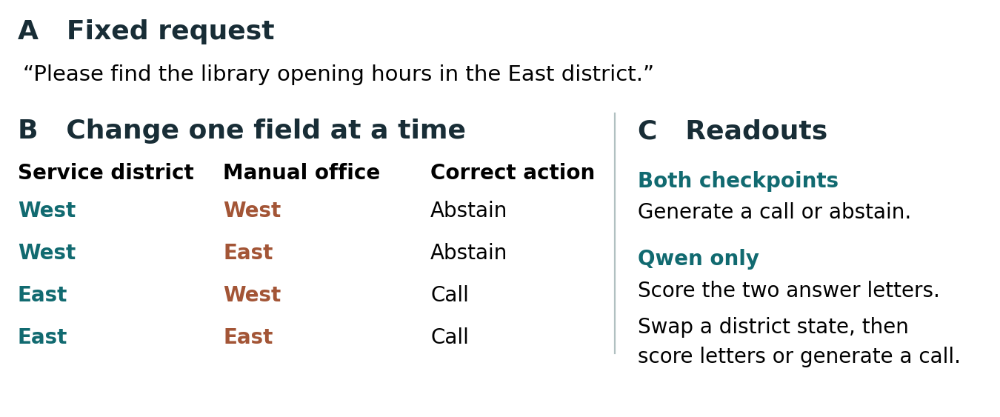
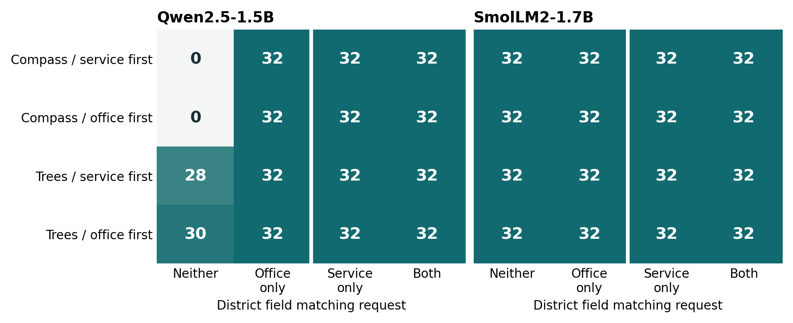
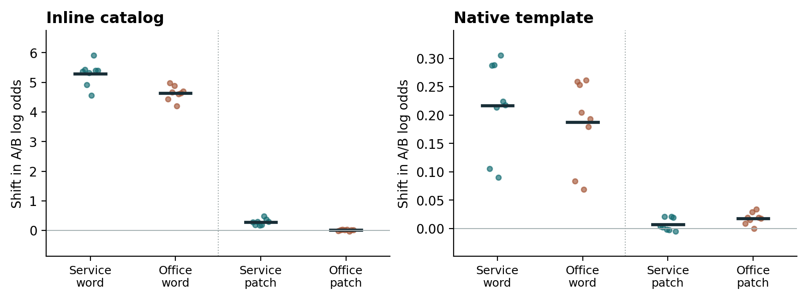
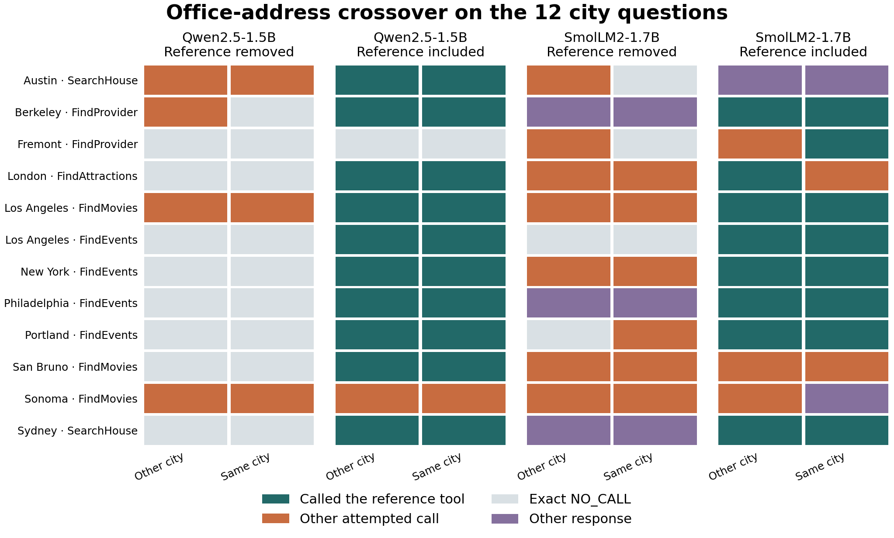

# When a tool’s documentation address matches the request

## Abstract

A service can operate in one district and maintain its documentation office in another. Can a language model distinguish the location that determines whether it should call the service? Two instruction-tuned models received the same 512 fictional directory requests. Changing only the office to the requested district, while keeping the service out of scope, converted 70 of 128 paired Qwen2.5 decisions from abstention to a call. SmolLM2 attempted a call on both members of all 128 pairs. Both models supplied the correct function and argument on all 256 in-scope cards. In a follow-up on 32 compass-district false calls, replacing the office word’s input embedding prevented every error. Swapping its activation halfway through Qwen prevented none. Seeing the irrelevant address mattered to Qwen’s decision, but this single internal site was insufficient to reverse it. In 12 externally sourced location requests, matching the office city yielded one fewer false-call attempt for each model. The large Qwen effect in the fictional directories did not recur in this held-out catalogue.

## Introduction

Function-calling benchmarks ask whether an assistant can pick an available tool or recognize that none applies [3, 4]. A model can produce impeccable JSON while using a service outside its documented coverage. In Mateenah Jahan’s earlier TARA project [1], Qwen2.5 attempted a call on 9 of 32 irrelevant requests with an inline catalog and 16 of the same 32 with its native tool template [2]. Those responses show an interface difference. They leave open which part of a tool description affected the decision.

A documentation-office address provides a simple test. It can match the request word for word while conveying no information about coverage. Varying that address independently of the service district separates the effect of seeing a place name from the effect of assigning that name to the right field.

## Methods

Eight fictional tools offered local information such as library hours and ferry schedules. Each card specified one service district and one office district. The instruction defined the office as the place where the manual was written. For a fixed request, each field independently named either the requested district or its paired alternative (Figure 1). The four target slots used East/West and North/South or Cedar/Maple and Birch/Pine. Crossing tool, target, field order, vocabulary and both match indicators produced 512 inline cards per checkpoint [5, 6]. Each model generated one response per card by greedy decoding. No external service received a call.

**Figure 1. What determines coverage?** The four descriptions serve the same East-district request. Moving the manual office from West to East leaves the correct action unchanged. Both checkpoints received the free-response task. Qwen also received a two-letter coverage question. The single-site intervention was tested separately during each task.

The primary paired comparison held the service outside the requested district. It counted switches in both directions as the office changed from a mismatch to a match. A call attempt, an exact function-and-arguments match and a literal abstention were scored separately from the complete response. The second-checkpoint protocol was fixed locally after the Qwen outcomes were known and before SmolLM2 inference. All 512 rendered prompts matched across checkpoints. These are descriptive counts for a constructed bank with eight shared-template tools.

A separate Qwen experiment used compass districts, inline and native interfaces, and reversed A/B answer keys. The outcome was the first-token logit for the letter meaning “covered” minus the logit for the other letter. For each of 512 judgments, the service word or office word was changed, one at a time. A second test left the text intact and substituted the corresponding word’s residual activation from the counterfactual prompt immediately after decoder block 14 of 28. Signs were oriented toward a district match. Activation patching measures the contribution of the chosen site to the chosen readout [7]. A follow-up applied the same block-14 swap at prompt prefill and let Qwen generate the rest of its response. Each of the 128 original inline compass prompts served once as a recipient for each field. Identity swaps and input-embedding swaps tested whether the generation pipeline could reproduce the unmodified recipient and the full-text donor, respectively.

**Independently written tools.** We held out every exact question, function name and top-level description used above. We selected consumer-information questions with matching source text in BFCL Live Multiple and When2Call [3, 4]. These two releases share ancestry. In one experiment, the model saw the target alone or one distractor alone, under either its original function name or a neutral alias. In the second experiment, we changed only an added documentation-office city, keeping the externally written questions and descriptions fixed. All eligible location questions received the catalogue both with and without the target. The checkpoints generated text offline. We recorded attempts, parseable calls, schema validity and reference argument matches separately.

## Results

**The office mattered most when Qwen otherwise abstained.** With compass districts, changing only the office switched Qwen from abstention to a false call in 64/64 pairs. With tree names, it switched in 6/64 pairs. Qwen already called on the other 58 cards when neither field matched. No pair switched in the opposite direction (Figure 2). Both field orders showed the vocabulary difference.

**Figure 2. Generated calls in each cell of the matched bank.** Each entry counts attempts among 32 cards, one for each of eight services and four requested districts. The first two columns are out of scope. Only the office address changes between those columns. The last two columns are in scope.

**SmolLM2 called under every condition.** It attempted calls on all 256 out-of-scope and all 256 in-scope cards. Its office-match contrast was zero because it always called. Of its 256 false attempts, 218 supplied the expected arguments and 38 placed the district inside an extra JSON object. Qwen made 186 false attempts, all with valid arguments. Both models gave exact calls for every in-scope request. Requiring valid arguments would therefore undercount one model’s attempts to use an unavailable service (Figure S1).

**The answer-letter intervention depended on the interface.** For inline judgments, changing the service district increased Qwen’s coverage margin by 5.29 log-odds units on average. Changing the office district increased it by 4.64. Replacing the block-14 state at those positions shifted the margin by 0.286 and 0.012, respectively. For the native template the two patch effects were 0.007 and 0.018 (Figure 3). Native prompts assigned A and B only 0.00000050 of next-token probability on average, compared with 0.99938 inline. In a separate free-response run, Qwen called on all 128 native cards, including all 64 out-of-scope requests.

**Figure 3. Effects on Qwen’s first-token letter preference.** Each dot averages the matched comparisons within a tool. Horizontal markers show the equally weighted eight-tool mean. “Word” changes one prompt token. “Patch” swaps its block-14 activation while keeping the prompt fixed. The panels have different vertical scales. This figure reports the two-letter task.

**The block-14 swap changed an argument but never the decision to call.** Changing the actual office word from a matching to a mismatching district prevented all 32 office-only false calls on the original compass cards. Replacing its input embedding did the same. Replacing its block-14 state prevented 0/32. In the reciprocal direction the embedding induced 32/32 false calls, while the block-14 swap induced none. Both block-14 interventions retained all 64 exact in-scope calls. One out-of-scope park-closure response changed the district argument from South to North and still attempted a call (Figure S2).

### The documentation-office effect did not reproduce on external descriptions

Both models selected the available reference tool on 21 of 23 questions when presented alone under its original name. When only a distractor was available, Qwen emitted schema-valid wrong-tool calls in 3/60 presentations and Smol in 24/60. Smol made 48 recognizable attempts in those 60 presentations. Some attempted outputs copied part of the schema or ended in invalid JSON. Masking function names increased schema-valid distractor calls to 4/60 for Qwen and 38/60 for Smol (Supplement S6).

In the catalogue crossover, each of 12 questions named a city. When the reference tool was absent, changing its documentation office from a different city to the requested city reduced Qwen’s attempted calls from 4/12 to 3/12 and Smol’s from 7/12 to 6/12. Qwen gained no calls and lost one. Smol gained one and lost two. With the reference present, Qwen selected it on 10/12 questions in both conditions and Smol on 8/12 in both. This small external set supplies a direct limit on the original finding.

**Figure 4. Each question serves as its own office-address control.** Pairs share the request and externally written catalogue. The only change is the city in an added documentation-office sentence. The reference-absent endpoint counts recognizable attempts. The reference-present endpoint counts selection of the correct function. Supplement S6 reports ambiguous strings and the effect of accepting calls wrapped in a JSON list.

## Discussion

The comparison distinguishes two ways to fail the same coverage rule. Qwen was sensitive to an incidental word when the underlying prompt left room for abstention. SmolLM2 attempted a call even on the easiest mismatch controls. An office-only test without those controls would make both models appear equally sensitive to a misleading address.

The experiment identifies a behavioral effect at the input and a limit to its localization. A mid-layer intervention moved the inline model’s explicit coverage score, yet neither the service nor office swap changed any of 128 decisions during free generation. By the chosen layer, other positions might already carry the district information. The experiment did not test those positions or other depths. The native template also made a two-letter readout a poor proxy for what the model would generate.

The held-out catalogues preserve the office manipulation while changing the questions, tools and source of the descriptions. The earlier positive effect may depend on the fictional directory’s explicit service district or its prompt format. A larger set that independently varies those two features could distinguish them. Tracing earlier layers would be informative if candidate sites were selected on separate prompts and then evaluated for both false calls prevented and valid calls lost. Two checkpoints on one template do not establish how often this error occurs in deployed assistants.

## Data and contributions

[Prompts, complete responses, code and paired counts](README.md) accompany the paper. Mateenah Jahan’s original study motivated the coverage experiment [2]. Codex designed and ran the follow-up analyses and drafted this report.

## References

1. Technical Alignment Research Accelerator. [Official program description](https://www.taraprogram.org/).
2. Jahan M. [TARA tool-calling study, archived code and responses](https://github.com/MateenahJAHAN/tara-chat-tool-study/tree/b0676becc8354be9849c165db6276f35ce0709ca).
3. Patil SG, Mao H, Yan F, et al. The Berkeley Function Calling Leaderboard (BFCL): From Tool Use to Agentic Evaluation of Large Language Models. ICML, 2025. [Proceedings](https://proceedings.mlr.press/v267/patil25a.html).
4. Ross H, Mahabaleshwarkar AS, Suhara Y. When2Call: When (not) to Call Tools. NAACL, 2025. [doi:10.18653/v1/2025.naacl-long.174](https://doi.org/10.18653/v1/2025.naacl-long.174).
5. Qwen Team. [Qwen2.5-1.5B-Instruct model card and checkpoint](https://huggingface.co/Qwen/Qwen2.5-1.5B-Instruct/tree/989aa7980e4cf806f80c7fef2b1adb7bc71aa306).
6. Hugging Face. [SmolLM2-1.7B-Instruct model card and checkpoint](https://huggingface.co/HuggingFaceTB/SmolLM2-1.7B-Instruct/tree/31b70e2e869a7173562077fd711b654946d38674).
7. Zhang F, Nanda N. Towards Best Practices of Activation Patching in Language Models: Metrics and Methods. ICLR, 2024. [Author manuscript](https://arxiv.org/abs/2309.16042).
