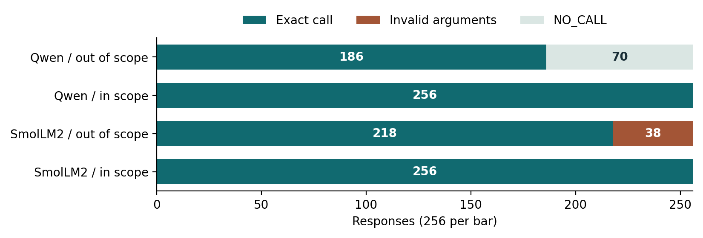
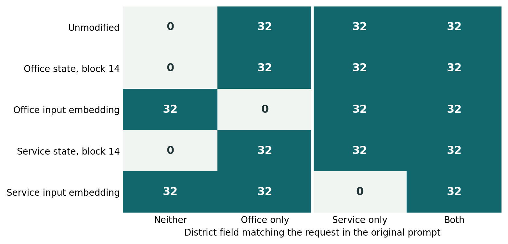
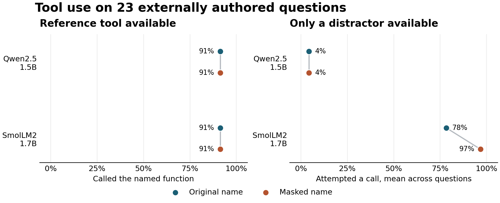

# Supplementary methods and results

## S1. Prompt construction and inference

Each request asked about exactly one district. The library example used the description “Use this service to look up library opening hours.” This was followed by the service district and the documentation-office district in the assigned order. The JSON schema required one string argument named *district*. The eight services concerned libraries, ferries, parks, museums, buses, recycling, pools and street markets. The complete text and token IDs are recorded for each card.

Both checkpoints used a new context per card, greedy decoding, a 72-token ceiling, float32 weights and eager attention on Apple Metal. The runs stopped at the checkpoint’s end-of-sequence token. The model-specific chat templates produced byte-identical rendered text for all 512 cross-checkpoint comparisons. Their token IDs differ. Both model weights and tokenizers are identified in the archived manifests.

The original Qwen free-response experiment comprised 128 inline and 128 native compass cards. Its field order alternated by tool and target. The vocabulary experiment repeated its 128 inline cards and added 384 cards. The repeated items matched byte for byte in prompt, input tokens, generated tokens, finish reason, response and scores. They enter the 512-card comparison once. The 512 SmolLM2 responses were newly generated against that bank. The separate 512 Qwen judgment prompts requested a single answer letter. The judgment experiment involved 1,024 residual swaps. A separate run tested the block-14 site during call generation (section S4).

## S2. Paired decisions and argument errors

A pair has the same tool, requested district, field order and vocabulary. Its service is out of scope on both cards. Only the second card names the requested district as the manual office. Table S1 gives switches from abstention to an attempt and the reverse. For sensitivity it also counts transitions between argument-invalid and exact responses on SmolLM2, whose attempts were universal.

**Table S1. Responses to changing the office address.** Each row contains 32 pairs. The Qwen exact-call switches equal its attempt switches. In the last column positive means an invalid call became exact and negative means an exact call became invalid.

| District names | First field | Qwen attempts, gain / loss | SmolLM2 attempts, gain / loss | SmolLM2 exact calls, gain / loss |
|---|---|---:|---:|---:|
| Compass | Service | 32 / 0 | 0 / 0 | 0 / 0 |
| Compass | Office | 32 / 0 | 0 / 0 | 0 / 13 |
| Trees | Service | 4 / 0 | 0 / 0 | 0 / 0 |
| Trees | Office | 2 / 0 | 0 / 0 | 1 / 14 |

The office change raised Qwen’s attempt rate by 54.7 percentage points across the constructed bank (70/128). For SmolLM2 the difference was zero points for attempts and −20.3 points for exact calls (one gain and 27 losses among 128 pairs). Using exact JSON alone would conflate a change in argument structure with a decision to abstain.

**Figure S1. Call validity and abstention from the full generated string.** Each bar contains 256 responses. All 38 argument-invalid responses used the correct function name but nested the requested district under an extra *properties* key. Neither checkpoint produced a truncated or unclassifiable response on the 512-card comparison.

The independent parser decoded each entire response. It accepted the exact named function with the prescribed one-key argument object or the literal NO_CALL. It identified the extra nesting directly in all 38 remaining responses, then checked every classification against the frozen scoring rule. The archive contains all four cells for each of the eight individual tools. [Cell counts](paper_cells.csv) · [Paired switches](paper_pairs.csv) · [Counts by tool](paper_tools.csv) · [Independent recount](paper_behavior_audit.json).

## S3. The intervention and its controls

The Qwen judgment bank reversed which letter meant that the tool covered the request. The service and office contrast for a given recipient each used a donor that differed at just one input token. One intervention overwrote the output of decoder block 14 at that service token. The other did so at the office token. Later positions kept the recipient state at the intervention layer. Both directions of each swap were measured.

On 32 prespecified recipients, replacing the block-14 state with itself left the margin unchanged. In two sets of 32 embedding controls, replacing the sole differing input embedding reproduced the corresponding donor margin exactly. These checks establish that the swap implementation and token pairing had the expected numerical effect at the input and under an identity intervention.

**Table S2. Service-minus-office contrasts in first-token log odds.** Eight tools have equal weight. The range across deliberately chosen services and leave-one-service-out estimates describes sensitivity to service composition. The native rows contribute to these predeclared overall means despite their negligible A/B probability. Figure 3 reports both interfaces separately.

| Intervention | Eight-tool mean | Individual tool range | Leave-one-tool-out mean range |
|---|---:|---:|---:|
| Change the district word in the prompt | 0.338 | 0.141–0.673 | 0.291–0.367 |
| Replace the block-14 state at its position | 0.132 | 0.063–0.249 | 0.115–0.141 |

In the inline interface either A or B was the highest-probability token on all 256 judgment prompts. The more likely letter gave the correct answer on 159/256. With the native template, the most likely token was the opening tool-call tag on all 256 prompts, even when the question requested a letter. Forced-choice accuracy was 128/256. The native tool template changes the surrounding system text as well as the catalog rendering. This experiment cannot isolate the effect of schema markup. [Per-card logits](run_01/raw.jsonl) · [Service means](family_effects.csv) · [Numerical checks](independent_checks.json).

## S4. Activation swaps during free generation

The [generation intervention protocol](action_intervention/PROTOCOL.md) fixed the primary comparison before collecting new responses. One quartet comprised one tool and requested district, with all four combinations of service and office match. The full bank comprised 32 quartets. At prefill, the office or service word’s residual state from a donor replaced the recipient’s state at the same token immediately after block 14. Other positions retained the recipient state. The model then generated to its usual stop token or the 72-token ceiling, with ordinary attention caching. The comparison used all 128 original inline compass requests and their original field order.

Each quartet was batched with unaltered donor rows and five companion conditions for each recipient. The block-14 identity control copied the service-position state from the corresponding unmodified prompt. The positive controls replaced either the office or service input embedding with the donor’s. A single input token differed, so the positive controls should regenerate the donor sequence even when the action changes.

**Figure S2. Free calls after a one-token intervention.** Each entry counts attempted calls among 32 original inline compass prompts. The service and office swaps take their donor state from the opposite field-match condition at that same position. Each input-embedding result reproduced the donor’s entire generated token sequence. Swapping the block-14 office state changed the district argument in one false call, which still counts as a call.

All 768 generations finished before the token limit. Every unmodified response reproduced the archived sequence (128/128), and every identity swap reproduced its unmodified recipient (128/128). All 256 input-embedding controls reproduced the appropriate full-text donor, including its generated tokens. Neither block-14 swap created or prevented an attempted call in any cell. Both retained all 64 originally exact in-scope responses. The office swap produced one inexact response on an out-of-scope card, giving 31/32 false attempts with the expected district instead of 32/32. Inspection of that complete response showed the named argument changed from South to North. There were no unclassified responses. Generation took 356 seconds on Apple Metal. The independent recount decoded every response and compared it with its archived score. [All 768 responses](action_intervention/run_01/raw.jsonl) · [Transitions and exact calls by cell](action_intervention/cells.csv) · [Control comparisons](action_intervention/verification.json) · [Run manifest](action_intervention/run_01/run.json).

## S5. Reproduction and source data

The [judgment plan](PROTOCOL.md), [free-generation plan](ACTION_PROTOCOL.md), [vocabulary transfer plan](TRANSFER_PROTOCOL.md) and [second-checkpoint plan](REPLICATION_PROTOCOL.md) record the order in which the questions were posed. They were frozen locally. The archive records response hashes, code hashes and the full checkpoint revisions in [Qwen judgment](run_01/run.json), [Qwen action](actions_01/run.json), [Qwen vocabulary transfer](transfer_01/run.json) and [SmolLM2 replication](replication_01/run.json) manifests. [Reproduction commands](README.md)

## S6. External questions, functions and held-out descriptions

The 23 external requests cover eight target functions and 60 distractor presentations. The 23 questions, 23 names and 63 distinct descriptions had zero normalized exact matches in our earlier study. BFCL supplied the schemas and reference arguments. One reference required the genre “Any,” which its schema excludes. At most 22/23 targets can satisfy both. [Frozen selection and protocol](independent_descriptions/PROTOCOL.md) · [Overlap check](independent_descriptions/holdout_check.json) · [Schema and reference audit](independent_descriptions/reference_audit.json)

| Single offered tool | Target named with arguments / 23 | Target passed schema and reference / 23 | Distractor attempts / 60 | Distractor named with arguments / 60 | Distractor passed schema / 60 |
|---|---:|---:|---:|---:|---:|
| Qwen2.5, original name | 21 | 14 | 3 | 3 | 3 |
| Qwen2.5, name masked | 21 | 13 | 4 | 4 | 4 |
| SmolLM2, original name | 21 | 10 | 48 | 40 | 24 |
| SmolLM2, name masked | 21 | 6 | 58 | 55 | 38 |

Giving each question equal weight, distractor attempt rates were 4.35% under both names for Qwen, and 78.26% and 96.74% for Smol. With original names, four Smol attempts echoed the schema and six had invalid or incomplete JSON. These categories overlap. [All single-tool counts](independent_descriptions/cells.csv)

**Figure S3. Single-tool decisions under original and masked names.** Each model received both naming conditions for the same question–tool pairs. Source questions contribute different numbers of distractors. The table gives pooled counts and the text gives equal weight to each question.

The catalogue experiment used all 12 eligible location questions. Three reference-absent catalogues contained one distractor and nine contained two to seven. The mismatched city assignment preserved the overall frequency of each city. Under the frozen parser, Smol produced three unclassified outputs in each reference-absent office condition. A sensitivity analysis that accepts calls embedded in a JSON list raised its counts from 7 and 6 to 9 and 8, preserving the one-call net difference. All 428 replies are available for blind coding. [Catalogue protocol](independent_descriptions/CATALOGUE_PROTOCOL.md) · [All paired comparisons](independent_descriptions/catalogue_pairs.csv) · [Output format audit](independent_descriptions/single_output_format_summary.csv) · [Blind packet](independent_descriptions/TARA_Blind_Review.zip)
